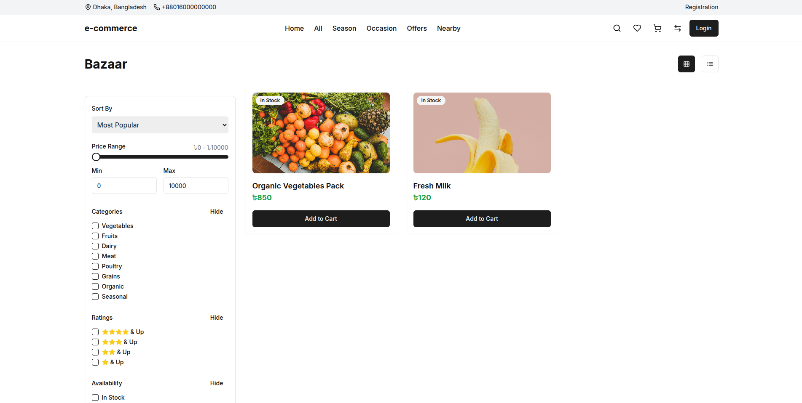

# E-commerce

A responsive grocery and farm-products storefront built with Next.js. Customers can browse products, search and filter the catalog, view product details, manage a locally persisted cart and favorites, compare products, and explore seasonal items, offers, and nearby farms.

## Bazaar preview



## Project structure

```text
app/
  page.tsx                 Home page
  layout.tsx               Shared site layout, header, footer, and notifications
  not-found.tsx            Custom 404 page
  bazaar/                  Product catalog and filters
  product/[id]/            Product detail page
  search/                  Search results and filters
  cart/                    Cart page and cart components
  checkout/                Checkout page
  favorites/               Saved products
  compare/                 Product comparison
  seasonal/                Seasonal product listings
  offers/                  Deals and promotions
  occasion/                Occasion categories and featured products
  nearby/                  Nearby farm listings
  login/                   Login page and form
  registration/            Registration page and form
components/
  cart/                    Cart drawer and shared cart UI
  search/                  Search bar, drawer, and suggestions
  product/                 Product detail drawer
  ui/                      Shared UI primitives
  header.tsx               Global navigation
  footer.tsx               Global footer
lib/
  products.ts              Product data and lookup/search helpers
  store.ts                 Zustand cart, favorites, and comparison state
hooks/                     Shared React hooks
types/                     Shared TypeScript types
public/                    Static assets
e.png                      Bazaar screenshot used in this README
```

## Tech stack

- Next.js 13 App Router and React 18
- TypeScript and Tailwind CSS
- Radix UI-based components
- Zustand with browser storage persistence for shopping state

Catalog, offer, and farm data is currently provided by local sample data; the project does not currently connect to a backend service.

## Run locally

```bash
npm install
npm run dev
```

Open [http://localhost:3000](http://localhost:3000). Create a production build with `npm run build`.
